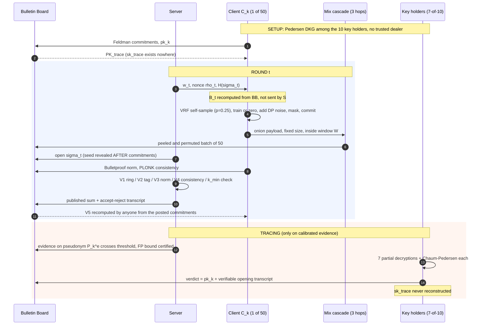

# JANUS-FL — Architecture Specification

**Anonymously Authenticated, Verifiably Private, and Accountably Traceable Federated Learning**

Target: SCIE Q1/Q2 journal. Repo: `FL-ZKP`.
Status: **rev. 3 — 2026-11-08. All ten limitations from `REVIEW.md` addressed; scale raised to `n = 50`; compute budget re-derived (~100 GPU-hr, down from 160).**

---

## 0. What changed in rev. 3

| # | Change | Driver |
|---|---|---|
| C1 | `n = 20 → 50` clients; ring size 50; committee of **10 key holders**, threshold **`t = 7`** | your instruction |
| C2 | **Anonymous submission channel constructed, not assumed** — 3-hop onion mix cascade, fixed windows, padded payloads, dummy traffic (§2.3) | fixes limitation 1 |
| C3 | **VRF self-sampling** at `p = 0.25` — only ~12 of 50 clients train per round, and *nobody* learns which (§5.5) | 4× GPU cut while *strengthening* anonymity |
| C4 | Groth16 → **PLONK** with the public universal SRS | removes per-circuit toxic waste (R2) |
| C5 | `B_t` **publicly derived** from the bulletin board, not chosen by the server | removes the censorship/de-anonymization oracle (R3) |
| C6 | **Distributed DP** module with bounded-noise proofs; formal `(ε, δ)` accounting with subsampling amplification | makes "privacy preserving" a proved claim (R4) |
| C7 | **Double-masking** in secure aggregation | removes the false-dropout unmasking oracle (R5) |
| C8 | **GroupNorm**, trained **from scratch** | BN is a non-IID failure mode *and* leaks local statistics (R12); pretrained weights make MNIST vacuous (R13) |
| C9 | Epoch `R = 25` rounds, constrained by `p · R ≥ 5` | sampling and evidence accumulation interact — see §6.1 |
| C10 | Train/val/test splits fully specified, including **writer-disjoint** FEMNIST evaluation | your instruction; see `ROADMAP.md` §3.4 |

---

## 1. Three corrections to the original brief

### 1.1 ZKP does not protect confidentiality

A ZKP is a **soundness** mechanism: it convinces a verifier that a statement about hidden data is true. It does not hide the data — the data is hidden by whatever **encryption or masking** wraps it. A client that sends plaintext weights alongside a proof has sent plaintext weights.

Two separable layers, stated explicitly in the paper:

| Property wanted | Mechanism that delivers it |
|---|---|
| Server cannot read an individual update | masked secure aggregation over a homomorphic Pedersen commitment, with double-masking |
| Server can nevertheless *check* the update is well-formed and bounded | NIZK over the commitment (Bulletproofs range proofs) |
| Server cannot learn *who* sent which update | linkable ring signature + onion mix cascade |
| Server cannot learn *who participated* | VRF self-sampling + dummy traffic |
| A malicious client can later be named | threshold-ElGamal identity escrow, opened `t`-of-`n_c` |
| The released aggregate itself does not leak | distributed DP with a proved `(ε, δ)` |

This is the answer to *"the Manager who opens the updates shouldn't read plain text."* **No party holds both secrets**: the server holds mask-cancelled sums and no identities; the committee holds identity-decryption shares and never touches weights; the mix nodes see ciphertext and permutations and neither. Call it **privilege separation** and make it a stated design principle.

### 1.2 Reconstructing the Shamir secret is the wrong primitive

Reconstructing `sk_trace` is a one-way door: whoever assembles it can de-anonymize **every past and future round**, unilaterally, forever. The escrow is burned by its first use.

Use **threshold decryption without reconstruction**. Each cooperating committee member computes a *partial decryption* of the one identity ciphertext under scrutiny, plus a Chaum–Pedersen proof that the partial is correct. The partials combine to reveal exactly one identity; `sk_trace` is never assembled anywhere. This buys least privilege, **non-frameability** (the committee cannot output an identity that was not escrowed), and **public auditability** (the opening transcript is independently checkable).

Shamir is still central — it is how the DKG shares `sk_trace` across the 10 key holders. It is simply never *reassembled*.

### 1.3 The key holders are a selected committee of 10, with threshold 7

**Per your instruction: `n = 50` clients, **10 key-holding clients** selected from them.**

```
Clients          n    = 50          ring size 50 for every signature
Key holders      n_c  = 10          selected subset, roster public on BB
Threshold        t    = 7           7 of the 10 must cooperate to open one identity
Epoch            e                  a committee generation (roster version)
Opening          7 committee partials  +  server authorization signature
```

**Why `t = 7` and not 10.** If `t = n_c` the scheme is **unanimity**: one key holder offline, crashed, or simply uncooperative and tracing is impossible. Accountability becomes the easiest thing in the system to kill, and a malicious client's optimal strategy is to get onto the committee and stop answering. `t = 7` of 10 keeps a 70% collusion requirement — higher than the 2/3 standard in Byzantine agreement — while tolerating 3 absences.

| Config | Dropouts tolerated | Collusion needed | Note |
|---|---|---|---|
| `t=10, n_c=10` | **0** | 10 of 10 | unanimity; accountability trivially DoS-able |
| **`t=7, n_c=10`** ← default | 3 | 7 of 10 (70%) | recommended |
| `t=6, n_c=10` | 4 | 6 of 10 (60%) | more live, weaker |

Both are config lines (`committee.t`, `committee.n_c`). If you want strict 10-of-10, set it and the paper concedes the liveness hole explicitly.

**The danger the roster introduces, and the guardrails.** Concentrating `sk_trace` in a small, *publicly named* roster is easier to attack than diffusing it over all 50: the adversary needs only the specific parties the roster names. And since the server maintains the roster and an admin can replace members, **a malicious server could replace key holders with sock puppets and then de-anonymize every client unilaterally** — a total break against adversary `A1`. So:

1. **The server cannot reconfigure alone.** A roster change needs `t = 7` signatures from the **outgoing** committee plus the admin signature. The admin proposes; the incumbents execute. (§6.4)
2. **Reconfiguration is proactive resharing, not re-keying.** `PK_trace` is invariant across epochs while shares rotate, so escrow ciphertexts from every earlier round stay openable and nothing is re-encrypted.
3. **Changes are visible and delayed.** Every transition is posted to `BB` and takes effect after `Δ = 2` rounds, so a client who sees the roster being captured can withhold participation before its next update is escrowed to a committee it does not trust.

---

## 2. Entities and threat model

### 2.1 Entities

| Entity | Count | Holds | Honest? |
|---|---|---|---|
| Client `C_k` | `n = 50` | local data `D_k`, keypair `(sk_k, pk_k)`, pairwise mask seeds; a VSS share **only if** `k ∈ C^(e)` | up to `f < 25` Byzantine |
| Aggregation server `S` | 1 | global model `w_t`, public params, verification keys | **malicious** (`A1`) |
| Key-holder committee `C^(e)` | `n_c = 10` | one VSS share of `sk_trace` each | at most `t−1 = 6` colluding |
| Mix cascade `M^(t)` | `s = 3` per round | onion layer keys; rotated per round; **disjoint from `C^(e)`** | at most `s−1 = 2` colluding |
| Admin | 1 | roster-proposal key | may propose members; **cannot** install them alone |
| Bulletin board `BB` | 1 | append-only log of commitments, proofs, verdicts, rosters | honest append-only |

### 2.2 Adversary model

- **`A1` Malicious-but-covert server.** Wants to read individual updates, de-anonymize clients, bias aggregation, or censor specific clients — but will not deviate detectably, since all its inputs and outputs are on `BB` and publicly recomputable (V5, §4).
- **`A2` Byzantine clients, `f < n/2 = 25`.** Arbitrary deviation: poisoned data, crafted updates, replay, multi-submission, collusion with `S`.
- **`A3` Tracing cabal, `≤ t−1 = 6` key holders**, possibly colluding with `S` and the admin.
- **`A4` Mix cabal, `≤ s−1 = 2` mix nodes**, possibly colluding with `S`.
- **`A5` Static corruption, random oracle model.** Corruptions fixed before the protocol.

**Out of scope, stated as limitations:** fully adaptive corruption; the server withholding the global model from a targeted client (availability); client-hardware side channels; and the fact that norm bounds do not stop every attack — RoFL showed bounds are of limited effect against attacks exploiting model memorization, and the paper concedes this rather than overclaiming.

### 2.3 Anonymous submission channel ★ (this is limitation 1, fixed)

A ring signature over a connection that identifies you is theatre. CLSAG hides the signer among 50; the TCP connection, source address, TLS session and arrival order identify exactly who connected. In a single-process simulation this is invisible, which is precisely why it would ship undetected. Prior ring-signature systems papers assume an anonymous channel. **JANUS-FL constructs one.**

Four mechanisms, each closing one linkage channel:

| Channel | Leak | Mechanism |
|---|---|---|
| Network address | `S` sees who connected | **3-hop onion mix cascade** (below) |
| Arrival time | training time ∝ dataset size ⇒ identity | **fixed submission window** `W`; local training padded to a common deadline |
| Payload length | model size / sparsity pattern ⇒ identity | **fixed-size padded payloads**, identical for every client |
| Participation | who trained this round ⇒ identity over time | **VRF self-sampling + dummy traffic** (§5.5) — all 50 always submit |

**The cascade.** Client `k` onion-encrypts its submission to a 3-node path:

```
payload_k = ( c_k , τ_k , σ_k , I_k^t , P_k^e , π_k^norm , π_k^cons )   # signed, never re-randomized
onion_k   = Enc_{pk_{M1}}( Enc_{pk_{M2}}( Enc_{pk_{M3}}( payload_k ) ) )

M1: peels layer 1, PERMUTES the batch of 50, forwards
M2: peels layer 2, PERMUTES, forwards
M3: peels layer 3, PERMUTES, posts the batch to BB
```

- `M1` sees 50 source addresses but only ciphertext. `M3` sees 50 plaintext payloads but no addresses. Linking address → payload requires **`M1` and `M3` to collude**; with `s = 3` and per-round rotation by public randomness from `BB`, the adversary must corrupt a specific path it cannot predict.
- Onion layers wrap the payload *without modifying it*, so the CLSAG signature still verifies at the server. This is why onion encryption and not a re-encryption mixnet: re-randomizing `c_k` or `τ_k` would invalidate the signature over them.
- **Message-dropping is detectable by the victim.** Each client recognizes its own `c_k` on `BB`; if it is absent, the client posts a signed complaint. A mix node that drops messages is identified by elimination across rounds.
- Cost is **independent of `d`**: the shuffled objects are commitments, ciphertexts and proofs — a few KB each, 50 per round. No GPU cost at all.

Residual assumption, stated honestly: anonymity holds unless all of `{M1, M3}` collude. That is a far weaker and more standard assumption than "assume an anonymous channel exists," and it is the one every deployed mixnet makes.

---

## 3. Cryptographic stack

All primitives are **published schemes with reference implementations**. Nothing hand-rolled.

| # | Primitive | Instantiation | Why this one |
|---|---|---|---|
| P1 | Group | `ristretto255` (Curve25519) | prime-order, no cofactor bugs, in `libsodium` |
| P2 | Vector commitment | Pedersen, homomorphic | masks and commitments both add ⇒ the server's *sum* is publicly verifiable |
| P3 | Range / norm proof | **Bulletproofs** (Bünz et al.) | RoFL's finding: for range proofs over Pedersen commitments Bulletproofs substantially beat Groth16; log-size, batched, **no trusted setup** |
| P4 | Anonymous auth | **CLSAG** linkable ring signature, ring = all 50 `pk`s | dual-scope tags give per-round double-submission detection and per-epoch pseudonymity; well-vetted |
| P5 | Identity escrow | ElGamal on P1 under `PK_trace` | additively homomorphic, threshold-decryptable, 2 group elements |
| P6 | Threshold decryption | `(t=7, n_c=10)` Shamir over `Z_q` + Chaum–Pedersen per partial | no reconstruction; non-frameable |
| P7 | DKG | **Pedersen DKG** among `C^(0)`, Feldman-verified | **no trusted dealer** — nobody ever knows `sk_trace` |
| P8 | Cross-component NIZK | **PLONK via snarkjs**, universal SRS from the public perpetual Powers-of-Tau; Poseidon in-circuit | **no per-circuit toxic waste** (C4). Groth16 would let whoever ran setup forge `R_cons` — i.e. mount the exact framing attack the paper claims to prevent |
| P9 | Secure aggregation | pairwise masks (X25519 ECDH + HKDF) **plus per-client self-masks** | double-masking: a falsely-declared dropout cannot be unmasked (C7) |
| P10 | Committee rotation | **Proactive secret resharing** (Herzberg et al.), `PK_trace` invariant | roster churn without re-keying, re-encryption, or history loss |
| P11 | Anonymous channel | **Chaumian onion mix cascade**, `s = 3`, rotated | constructs the anonymous channel instead of assuming it (§2.3) |
| P12 | Participation sampling | **VRF** (ECVRF on P1), threshold `p = 0.25` | server cannot choose or learn who participates (§5.5) |
| P13 | Differential privacy | **distributed Gaussian** noise shares; Rényi-DP accountant with subsampling amplification | makes the aggregate release claim provable (C6) |

### 3.1 Why a hybrid proof stack

Two statements with opposite shapes:

- **Norm bound** — thousands of independent range constraints over a Pedersen commitment. Bulletproofs' native case; Groth16/PLONK would need an R1CS circuit over the whole vector.
- **Cross-component consistency** — one small, fixed, structurally complex relation (hash chains, group-element equalities, VRF check, ring binding). PLONK's native case; Bulletproofs would be slow and large.

Using one system for both is the mistake RoFL's evaluation warns against. **The two proofs are glued by a shared Pedersen commitment opening**, so there is no soundness gap between them (§5.4).

---

## 4. Round protocol

Setup (once): Pedersen DKG among `C^(0)` → `PK_trace`, shares `{s_j}`, Feldman commitments on `BB`. PLONK universal SRS fetched from the public ptau. Ring `R = {pk_1..pk_50}` published.

Round `t` of epoch `e`:

```
S  →  all:   w_t ,  nonce ρ_t ,  sketch-seed commitment h_σ = H(σ_t)
B_t  is NOT chosen by S:  B_t = median{ committed norms posted on BB at round t-1 } · κ
                          recomputable by anyone from BB          ← C5, kills the censorship oracle

C_k local:
  0. b_k  ← [ VRF(sk_k , ρ_t) < p·2^L ]         # self-sampling, p = 0.25, E[12.5 trainers]
  1. if b_k:  Δ_k ← LocalTrain(w_t, D_k) − w_t   else  Δ_k ← 0
  2. ν_k  ← share of distributed Gaussian noise  (σ_DP / √(p·n)) , ‖ν_k‖ ≤ B_ν
  3. q_k  ← Quantize(Δ_k + ν_k) ∈ Z_p^d          # fixed-point, 16-bit mantissa
  4. m_k  ← Σ_{j≠k} ±PRG(seed_kj)  +  selfmask_k # double-masked
  5. c_k  ← Ped.Commit(q_k + m_k ; r_k)
  6. τ_k  ← ElGamal.Enc(PK_trace , pk_k ; e_k)
  7. I_k^t ← sk_k · H_p(ρ_t)                     # per-ROUND tag  ⇒ no double submission
     P_k^e ← sk_k · H_p(ρ_e)                     # per-EPOCH pseudonym ⇒ evidence accumulates
     σ_k  ← CLSAG.Sign(sk_k , R , c_k‖τ_k‖I_k^t‖P_k^e‖ρ_t)

S  publishes σ_t  (sketch seed, opened against h_σ)   ← AFTER all c_k are on BB

  8. y_k  ← Π_{σ_t}(q_k) ∈ Z_p^m                 # JL sketch, m = 8192
  9. π_k^norm ← BP.RangeProve(y_k , B_t)
 10. π_k^cons ← PLONK.Prove(R_cons , witness = (sk_k, b_k, q_k, ν_k, m_k, r_k, e_k))

C_k →  M1 → M2 → M3 → BB:   onion-wrapped payload, FIXED SIZE, within window W
                             all 50 clients submit; ~38 are dummies with q_k = 0

S  reads the shuffled batch from BB and verifies, for each submission:
  V1  CLSAG.Verify(σ_k , R , ·)                  → anonymous authentication
  V2  I_k^t ∉ seen(ρ_t)                          → no multi-submission     (A3)
  V3  BP.Verify(π_k^norm , c_k , B_t)            → bounded update          (A1)
  V4  PLONK.Verify(π_k^cons , publics)           → no splicing, honest sampling, bounded noise  (A5)
  reject on any failure; log (transcript, verdict) to BB

  |A_real| ≥ k_min = 8   else ABORT the round     → no small-cohort unmasking  (P(abort) ≈ 4.5%)

C_k →  S:    r_k                                  # blinding factor, after acceptance only
S  →  BB:    Σ_{k∈A}(q_k + m_k) ,  Σ_{k∈A} r_k ,  A

ANYONE verifies the server:
  V5  Ped.Commit( Σ(q_k+m_k) ; Σ r_k )  ==  Π_{k∈A} c_k     → verifiable aggregation
                 w_{t+1} ← w_t + (1/|A_real|) · Dequantize(Σ q_k)
```

The server learns: `|A|`, the noised sum, and nothing else. No individual update, no identity, no participation set, no loss value.

**On V5.** Pedersen is homomorphic and every `c_k` is public, so *any* party recomputes `Π c_k` and checks the server's published sum in one multiplication. Without V5 the framework verifies clients and trusts the server, contradicting `A1` and leaving the ZK-FL survey's trust issue ⑤ (*model aggregation trust*) open. Revealing `r_k` after acceptance leaks nothing new: it opens `c_k` only to `q_k + m_k`, still masked, so recovering `q_k` still needs all 49 other clients — exactly the bound T1 states.

### 4.1 Protocol diagram (renders on GitHub)



---

## 5. The ZK statement suite

### 5.1 `R_auth` — anonymous authentication (CLSAG, not a SNARK)

> *"I know `sk_i` for some `pk_i ∈ R`; `I_k^t = sk_i·H_p(ρ_t)` is its round tag; `P_k^e = sk_i·H_p(ρ_e)` is its epoch pseudonym."*

| Tag | Scope | Purpose | Linkability |
|---|---|---|---|
| `I_k^t` | round `ρ_t` | reject a second submission in the same round | within one round only |
| `P_k^e` | epoch `ρ_e` (`R = 25` rounds) | let evidence accumulate against one client | within one epoch only |

**Why two tags.** A single per-round scope makes submissions unlinkable across rounds — but §6.1 accumulates evidence *over* rounds. Those requirements are mutually exclusive: with no link from round `t` to `t+1` there is nothing to accumulate and the traceability trigger is vacuous. The epoch pseudonym makes the granularity explicit and tunable: within an epoch a client is a stable pseudonym, across epochs unlinkable.

`R` is the **anonymity–accountability dial**:

```
R = 1     → full per-round unlinkability, zero accumulation, detection ≈ chance
R = 25    → default; with p = 0.25 that is ~6 observations per pseudonym
R = ∞     → persistent pseudonym, best detection, weakest anonymity
```

Sweep `R ∈ {1, 5, 10, 25, 50}` against detection rate and residual anonymity — that sweep is figure F7, and it costs almost nothing because it reuses the A2 runs.

### 5.2 `R_norm` — bounded, well-formed update (Bulletproofs)

> *"The sketch `y_k` committed in `c_k` satisfies `‖y_k‖_∞ < B_t` and `‖y_k‖_2² < B_t²`, is the `σ_t`-projection of a correctly quantized vector, and its noise component satisfies `‖ν_k‖ ≤ B_ν`."*

Gives Byzantine robustness at the gate — scaling attacks are *rejected before aggregation*, not down-weighted after it — and the clipping half of the DP guarantee. Implement both `L_∞` (per-coordinate, cheap) and `L_2` (requires committing to squares, RoFL's construction) and report both.

### 5.3 `R_share` — honest escrow and honest sharing (Σ-protocol + Feldman)

> *"`τ_k` is a well-formed ElGamal encryption under `PK_trace` of a value in `R`, and — if I am a key holder — my VSS share is consistent with the published Feldman commitments."*

A malicious client cannot evade traceability by escrowing garbage, and a malicious key holder cannot poison the share set. **This is what makes traceability sound rather than best-effort**, and it is missing from the FL traceability literature.

### 5.4 `R_cons` — cross-component consistency ★ NOVEL

> *"The secret key behind the round tag, the epoch pseudonym, the escrowed public key, the sampling decision, and the committed update all belong to the same party, in round `ρ_t`."*

Publics `(I_k^t, P_k^e, τ_k, c_k, ρ_t, ρ_e, PK_trace, root(R), B_ν)`, witness `(sk, b, q, ν, m, r, e)`:

```
  I_k^t = sk · H_p(ρ_t)                        ∧   # round tag
  P_k^e = sk · H_p(ρ_e)                        ∧   # epoch pseudonym, SAME sk
  τ_k   = ElGamal.Enc(PK_trace , sk·G ; e)     ∧   # escrow, SAME sk
  c_k   = Ped.Commit(q + m ; r)                ∧   # the update
  sk·G  ∈ R                                    ∧   # ring membership
  b     = [ VRF(sk , ρ_t) < p·2^L ]            ∧   # sampling, SAME sk  (§5.5)
  ( b = 0 ⇒ q = ν )                            ∧   # not sampled ⇒ noise only, no update
  ‖ν‖   ≤ B_ν                                  ∧   # bounded DP noise
  binding-hash(I_k^t ‖ P_k^e ‖ τ_k ‖ c_k ‖ ρ_t) is the CLSAG message
```

The repeated `sk` across five lines is the whole point: one witness, five public objects, no way to mix and match.

**Why this is the contribution.** Published threshold-openable ring signatures bind an opening ciphertext to a *signature transcript*. Nobody binds it to a *secure-aggregation commitment carrying a range proof*. Without `R_cons` the composition has a hole: a malicious client pairs **an honest client's escrow ciphertext** with **its own poisoned commitment**. Every individual check passes — ring signature verifies, norm proof verifies, escrow well-formed — and when the committee opens, **an innocent client is named**. In the FL setting this is an **identity-laundering / framing attack**, it is the most dangerous failure mode of the composition anyone would build first, and `R_cons` closes it at roughly 500 bytes and single-digit milliseconds of verification.

Three-beat story for the paper: *here is the composition everyone would build → here is the attack that breaks it → here is the relation that fixes it.*

### 5.5 `R_vrf` — anonymous participation sampling ★ NOVEL, and the compute fix

Standard FedAvg has the server sample a cohort each round. That is incompatible with anonymity: choosing who participates means knowing who participates, and repeated across rounds it de-anonymizes everyone.

So clients sample **themselves**, verifiably:

```
b_k = [ VRF(sk_k , ρ_t) < p · 2^L ]
```

- **The server cannot choose** the cohort — the VRF input is the public round nonce and the key is the client's own.
- **The server cannot learn** the cohort — `b_k` is a private witness; dummy traffic means all 50 clients submit a fixed-size payload every round.
- **The client cannot lie.** The VRF is deterministic given `(sk_k, ρ_t)`, and `R_cons` enforces the disjunction `b = 0 ⇒ q = ν`. A client that *was* sampled cannot claim to be a dummy to free-ride, and one that was *not* sampled cannot inject an update. This is why the disjunction must live inside the circuit rather than being a client-side choice.

**This is also what makes the GPU budget work.** At `p = 0.25` only ~12 of 50 clients train per round, cutting GPU cost 4× against all-50 training, while *strengthening* anonymity rather than trading it away. It additionally delivers DP **privacy amplification by subsampling**, which tightens the `(ε, δ)` accounting in §6.5 for free.

Cost: `k_min = 8` real contributors required before aggregation, so a round aborts with probability ≈ 4.5% (Binomial(50, 0.25)). Aborted rounds are retried with a fresh nonce.

---

## 6. Traceability subsystem

### 6.1 Evidence accumulation with a certified false-accusation bound ★ NOVEL

Published accountable-ring-signature work treats the opening *trigger* as out of scope. In FL the trigger is the hard part: under non-IID data **honest clients legitimately look anomalous**. A FEMNIST writer who only ever writes `{a, e, 3}` produces an update any naive detector flags. Opening on that is a false accusation — and in a regulated consortium a false accusation is worse than a missed detection.

```
per round, per accepted submission (identity unknown to S):
    ev^(t)  =  w1·cos-dist(q, median)  +  w2·‖q‖/B_t  +  w3·loss-delta-on-root-set
E_P^(e)     =  Σ_{t ∈ epoch e} ev^(t)             # keyed by the EPOCH PSEUDONYM P_k^e
open iff    E_P^(e) > θ(α, R, p, n)               # θ s.t. Pr[open | honest] ≤ α
```

Calibrate `θ` by a **conformal / permutation procedure on the server's clean root set**, which costs no new assumption — the ZK-FL survey's Veri-CS-FL already assumes a small clean root dataset at the server.

> **Theorem (bounded false accusation).** For any honest client `k`, `Pr[k is opened during epoch e] ≤ α`, with `α` tunable and independent of the data distribution, provided the root set is drawn from the global distribution.

**Sampling couples to this and constrains `R`.** With participation `p`, a client appears only `p·R` times per epoch. Too few observations and the test has no power. Require **`p · R ≥ 5`**; at `p = 0.25` that forces `R ≥ 20`, hence the default `R = 25`. State the constraint — it is the kind of interaction that silently guts a detector.

Report empirical FP rate against nominal `α` on IID **and** natural non-IID FEMNIST. This is the gap between "we can trace" and "we can trace safely."

### 6.2 Opening protocol

1. `S` posts evidence `E_P^(e)`, the epoch, the pseudonym, and the calibration certificate to `BB`.
2. Authorization gate: `t = 7` partials from the **current roster** `C^(e)` **plus** a server authorization signature. A key holder recuses itself if it is the accused.
3. Each computes `d_j = τ_k^{(1)} · s_j` plus a Chaum–Pedersen proof that `dlog(d_j)` matches its published Feldman share commitment.
4. Lagrange-combine the 7 partials → `pk_k`. `sk_trace` never assembled.
5. Verdict posted: `(pk_k, 7 partials, 7 CP proofs, evidence, certificate, roster epoch)`. **Any third party can re-verify the entire accusation**, including that the roster in force was not freshly captured.
6. **Consequence:** the named client's `pk` is revoked and the ring shrinks to 49. Note that this shrinks everyone else's anonymity set — another point on the F7 frontier, and the reason revocation is accounted for in §6.3 rather than treated as free.

### 6.3 Accountability–anonymity budget ★ NOVEL (conceptual)

Every opening permanently shrinks the effective anonymity set. Define **residual anonymity**

```
H(T) = log₂( n − o(T) )          o(T) = openings up to round T
```

and give a composition theorem over rounds and epochs. This is directly analogous to a DP budget and is unaddressed for accountable FL. Plot `H(T)` against detection rate to produce an **anonymity–accountability Pareto frontier** instead of asserting the two are "balanced." At `n = 50`, `H(0) ≈ 5.64` bits — materially better than the 4.32 bits at `n = 20`, which is a concrete benefit of the scale increase and worth saying.

### 6.4 Committee reconfiguration ★ NOVEL (required by the roster design)

```
Epoch e, roster C^(e), t=7, n_c=10, PK_trace fixed

1. PROPOSE   admin signs C^(e+1) → BB              (admin alone cannot install it)
2. CONSENT   t = 7 members of C^(e) sign the proposal
3. RESHARE   those members run proactive resharing:
                each picks a degree-(t-1) poly with ZERO constant term,
                distributes sub-shares to C^(e+1), Feldman-verified
             ⇒ new shares {s'_j} of the SAME sk_trace
4. ERASE     departing members delete s_j  (old shares no longer combine)
5. DELAY     effective at round t_now + Δ,  Δ = 2
6. LOG       transition appended to BB, publicly auditable
```

- **`PK_trace` is invariant.** Zero-constant-term polynomials leave the shared secret unchanged, so every escrow ciphertext from every past round stays openable by the *new* committee. No re-encryption, no history loss. This is why proactive resharing rather than a fresh DKG.
- **Forward security.** A member removed at epoch `e` loses tracing power at `e+1` even though it still holds its old share.
- **The server cannot capture the roster.** Step 2 requires incumbent consent; a malicious `S` or admin can propose anything and get nowhere.
- **Mobile-adversary resistance.** Running the resharing every epoch even with no membership change refreshes all shares, so an adversary compromising 6 members in epoch 1 and 6 more in epoch 2 still learns nothing.

**Residual trust that cannot be removed:** the *initial* committee `C^(0)`. If 7 of those 10 are adversarial from genesis, tracing is compromised and no later reconfiguration helps — the compromised set simply refuses consent. An assumption, not a solved problem.

### 6.5 Distributed differential privacy (limitation 2, fixed)

Masking hides individual updates. It does not hide the **sum**, which is released every round for 120 rounds. Multi-round aggregate release is a real leakage channel, and gradient inversion on small-cohort aggregates is not safe by assumption.

```
clipping     already enforced by R_norm:  ‖q_k‖_2 ≤ B_t          ← free, reuses the norm proof
noise        each client adds ν_k ~ N(0, σ_DP²/(p·n) · I)
             bounded by ‖ν_k‖ ≤ B_ν , proved in R_norm
sum          Σ_k ν_k ~ N(0, σ_DP² · I)   over the sampled cohort
accounting   Rényi-DP with subsampling amplification at rate p = 0.25
target       (ε, δ) = (≈3.0, 1e-5) over 120 rounds — report the measured curve
```

Clipping comes free because the norm bound is already proved; only the noise is new, and it costs no GPU. Report accuracy **with and without** DP so the privacy–utility cost is explicit.

**Be honest about what is proved:** we enforce **bounded** noise in zero knowledge, not **provably-Gaussian** noise. A client could under-noise within the bound. Full distributional proofs in ZK are an open problem; name it as future work and state the resulting trust assumption (honest-majority noise contribution) rather than implying more.

---

## 7. Novelty map

| # | Claim | Delta over the closest published work |
|---|---|---|
| **N1** | `R_cons` cross-component consistency + the identity-laundering attack and fix | first in FL; first to bind identity escrow to a *secure-aggregation commitment with a range proof* rather than to a signature transcript |
| **N2** | Calibrated opening trigger with a proven false-accusation bound under non-IID | accountable-signature work leaves the trigger out of scope; Byzantine-FL detectors have no FP guarantee |
| **N3** | Accountability–anonymity budget with composition over rounds | new formal notion |
| **N4** | Sketched norm proofs — prover cost independent of `d`, with a soundness theorem | RoFL's cost is linear in `d`, evaluated on small models |
| **N5** | Dealer-free threshold escrow with **verifiable committee rotation** (`PK_trace` invariant, server cannot capture the roster) | threshold opening is flagged as an easy generalization in the ARS literature but not done; no FL traceability work rotates its opener set |
| **N6** | Privilege separation under a malicious server: no party holds both weight-secrets and identity-secrets | the ZK-FL survey assumes an honest server |
| **N7** | Full system on ResNet-50 / EfficientNet-B0 / MobileNetV2, `n = 50`, IID + natural non-IID, 7 adversaries | ZKP-FedEval uses a 2-layer CNN; Veri-CS-FL small models |
| **N8** | Dual-scope tags with `R` as an explicit anonymity–accountability dial | resolves the accumulate-vs-unlink contradiction; makes N3 measurable |
| **N9** | **Anonymous channel constructed, not assumed** — onion cascade + windows + padding + dummies | ring-signature systems papers assume it; this one builds and measures it |
| **N10** | Publicly verifiable aggregation for free from commitment homomorphism (V5) | the ZK-FL survey lists trust issue ⑤ as open; RoFL trusts the server |
| **N11** | **VRF self-sampling** — verifiable participation the server neither chooses nor learns | FL client sampling is universally server-side; this is what makes anonymity survive across rounds, and it cuts compute 4× |

**Gap table for §II:**

| | update conf. | anon. auth. | anon. channel | ZK input validation | verifiable agg. | traceability | verifiable opening | no dealer | DP | malicious server |
|---|---|---|---|---|---|---|---|---|---|---|
| FedAvg | ✗ | ✗ | ✗ | ✗ | ✗ | ✗ | — | — | ✗ | ✗ |
| Bonawitz SecAgg | ✓ | ✗ | ✗ | ✗ | ✗ | ✗ | — | — | ✗ | partial |
| RoFL (S&P'23) | ✓ | ✗ | ✗ | ✓ | ✗ | ✗ | — | — | ✗ | ✗ |
| Veri-CS-FL | ✗ | ✗ | ✗ | metric only | ✗ | ✗ | — | — | ✗ | ✗ |
| ZKP-FedEval | metric only | ✗ | ✗ | metric only | ✗ | ✗ | — | — | ✗ | ✗ |
| CryptoFair-FL | ✓ | ✗ | ✗ | fairness only | ✗ | ✗ | — | — | ✓ | ✓ |
| Accountable/threshold RS | n/a | ✓ | assumed | ✗ | n/a | ✓ | ✓ | ✓ | n/a | n/a |
| **JANUS-FL** | **✓** | **✓** | **✓** | **✓** | **✓** | **✓** | **✓** | **✓** | **✓** | **✓** |

---

## 8. Security theorems to prove

| Thm | Property | Statement sketch | Reduces to |
|---|---|---|---|
| T1 | Update confidentiality | `A` controlling `S` and `≤ n−2` clients learns nothing about an honest `q_k` beyond the sum | DDH (Pedersen hiding) + PRG security |
| T2 | Anonymity | `A` controlling `S`, the admin, `≤ 6` key holders and `≤ 2` mix nodes cannot guess which of two honest clients signed, better than `1/2 + negl` | CLSAG anonymity + ElGamal IND-CPA + mix security |
| T3 | Scoped linkability | two accepted submissions with the same `ρ_t` from one `sk` ⇒ equal round tags ⇒ detected | DL hardness in ROM |
| T4 | Traceability soundness | every accepted transcript opens to exactly one `pk ∈ R` | `R_share` + `R_cons` soundness |
| T5 | **Non-frameability** | `A` controlling `S` and `≤ 6` key holders cannot produce an accepted transcript that opens to an honest `pk` | **`R_cons` soundness** — justifies N1. Requires P8's transparent setup; under Groth16 this theorem is false |
| T6 | Input validity | accepted ⇒ `‖q_k‖ ≤ B_t` except w.p. `≤ 2^{−λ} + δ_JL` | Bulletproofs soundness + §9 lemma |
| T7 | Bounded false accusation | `Pr[honest k opened in epoch e] ≤ α` | conformal calibration (§6.1) |
| T8 | Verifiable opening | a verdict accepted by `BB` implies the named `pk` was escrowed in that `τ` | Chaum–Pedersen soundness |
| T9 | Aggregation correctness | a `w_{t+1}` accepted by V5 equals the mean of exactly the accepted `q_k` | Pedersen binding |
| T10 | Reconfiguration safety | `A` controlling `S`, the admin and `≤ 6` key holders cannot install a roster it controls, nor open with stale shares | PSS security + the consent rule |
| T11 | Sampling integrity | `A` cannot bias its own participation rate away from `p`, nor learn an honest client's `b_k` | VRF pseudorandomness + uniqueness + `R_cons` |
| T12 | `(ε, δ)`-DP of the release | the sequence of published aggregates is `(ε, δ)`-DP at the client level | RDP composition + subsampling amplification, given honest noise contribution |

---

## 9. Making it scale: the sketched norm proof

**The problem.** ResNet-50 has ~23.5M parameters. A Bulletproofs `L_∞` proof needs one range constraint per coordinate. At an optimistic 10⁵ constraints/s that is ~4 minutes per client per round; `L_2` roughly doubles it. Infeasible, and the reason no published ZK-FL paper uses a realistic backbone.

**The fix.** Prove the norm on a random projection whose seed is fixed *after* the client commits.

```
1. Client commits:  c_k = Ped.Commit(q_k + m_k ; r_k)   → posted to BB
2. Server opens seed σ_t against the pre-published h_σ = H(σ_t)
3. Client proves:   ‖Π_{σ_t}(q_k)‖ ≤ B'  ,  Π ∈ {±1}^{m×d}/√m  (sparse Achlioptas)
```

**Lemma (sketched soundness).** For a JL sketch with `m = O(ε^{−2} log(1/δ_JL))`, if `‖Π q‖_2 ≤ (1+ε)B` then `‖q‖_2 ≤ B` except with probability `≤ δ_JL`. Commit-before-seed makes the adversary's `q` independent of `Π`, so nothing can be hidden in `ker Π`; Fiat–Shamir makes it non-interactive.

At `m = 8192, ε = 0.05`: cost drops from `d = 23.5M` to `8192` — **~3000×, and constant in `d`**, so all three backbones cost the same to prove.

**Honest about the tradeoff:** `L_∞` is *not* JL-preserved, so report exact per-coordinate `L_∞` on a quantized top-`k` sparsified update (`k = 10⁵`) and sketched `L_2` on the full vector, with `δ_JL` tabulated. Ablate `m ∈ {1024, 4096, 8192, 16384}` against measured soundness and prover time.

---

## 10. Attack suite

| ID | Attack | Caught by | Expected result |
|---|---|---|---|
| **A1** | **Model-replacement / scaling**: `Δ = γ(w_target − w_t)`, `γ = 100` | `R_norm` (V3) | rejected at the gate, 0% backdoor success |
| **A2** | **Label-flipping poisoning** (`7→1`, 30% of the attacker's data) | passes V3 → §6.1 evidence → traced | detected within an epoch; names the right clients at FP ≤ `α` |
| **A3** | **Sybil / multi-submission under anonymity**: one client submits 5 updates | round key image (V2) | all but one rejected. This attack exists *only because* of ring signatures — it is what justifies linkability |
| **A4** | **Free-riding**: submit zero, replay round `t−1`, or falsely claim "not sampled" | lower norm bound + `ρ_t` binding + **VRF disjunction in `R_cons`** | rejected; the VRF is what closes the dummy-impersonation route |
| **A5** | **Identity-laundering / transcript splicing** ★ | **`R_cons` (V4)** | rejected. Ablate with `R_cons` off → innocent client framed. *The paper's money figure.* |
| **A6** | **Gradient inversion by a malicious server** (DLG / iDLG / Geiping) | masking (T1) + DP (T12) | reconstruction at chance; contrast against plaintext-FedAvg where it succeeds |
| **A7** | **Collusive de-anonymization**: 6 key holders + malicious `S` + 2 mix nodes | `(7,10)` threshold + server gate + 3-hop cascade | fails; validates T2 |

Ablation grid: for each defense component (V1–V5, mix cascade, VRF sampling, evidence trigger, DP), disable it and record which attack lands. The defense × attack heatmap is the single most convincing figure in the paper.

---

## 11. Repository layout

```
FL-ZKP/
├── README.md  ARCHITECTURE.md  ROADMAP.md  REVIEW.md
├── requirements.txt
├── crypto/
│   ├── ristretto.py            # P1
│   ├── pedersen.py             # P2
│   ├── clsag.py                # P4  dual-scope tags
│   ├── elgamal_threshold.py    # P5+P6
│   ├── dkg.py                  # P7
│   ├── committee.py            # roster epochs, consent rule
│   ├── reshare.py              # P10 proactive resharing
│   ├── secagg.py               # P9  double-masking
│   ├── mixnet.py               # P11 onion cascade, windows, padding, dummies
│   ├── vrf.py                  # P12 ECVRF self-sampling
│   ├── dp.py                   # P13 distributed Gaussian + RDP accountant
│   ├── sketch.py               # §9  JL projection, seed commitment
│   └── bulletproofs/           # P3  Rust ext (maturin) + fallback
├── circuits/
│   ├── consistency.circom      # R_cons  ★
│   ├── share_wellformed.circom # R_share
│   ├── poseidon/               # circomlib
│   └── build.sh                # PLONK setup from the public ptau
├── fl/
│   ├── models.py               # 3 backbones, GroupNorm, 1-ch stem, from scratch
│   ├── data_iid.py             # MNIST from Drive, 50-way stratified IID
│   ├── data_noniid.py          # FEMNIST writer partitions, writer-disjoint test
│   ├── splits.py               # ★ all train/val/test/root index files, seeded
│   ├── client.py  server.py
│   ├── evidence.py             # §6.1 accumulator + conformal calibration
│   ├── norm_rule.py            # C5 public B_t derivation from BB
│   └── trace.py                # §6.2 opening
├── attacks/  a1..a7
├── verifier/
│   └── audit.py                # ★ independent V5 + opening re-verification
├── notebooks/
│   ├── CASE1_IID_MNIST.ipynb
│   ├── CASE2_NONIID_FEMNIST.ipynb
│   └── CRYPTO_BENCH.ipynb
├── configs/*.yaml
└── results/
```

---

## 12. Decisions log

| # | Question | Decision |
|---|---|---|
| Q1 | ZKP statement suite | five relations: `R_auth`, `R_norm`, `R_share`, `R_cons`, `R_vrf` |
| Q2 | Proof system | hybrid: Bulletproofs (norms) + **PLONK** (consistency) + Σ-protocols (escrow, threshold decryption) |
| Q3 | Dimension | full model + sketched norm proofs (§9) |
| Q4 | Tracing authorization | `t = 7` key holders + server co-signature |
| Q5 | Key-sharing scope | **selected roster of `n_c = 10` key holders out of `n = 50`**, admin-replaceable via §6.4 |
| Q6 | Anonymity (limitation 1) | **constructed**: 3-hop onion cascade + fixed windows + padded payloads + dummy traffic |
| Q7 | Participation | **VRF self-sampling, `p = 0.25`**, `k_min = 8` |
| Q8 | Trusted setup | public universal SRS (PLONK); **Groth16 rejected** — it would make T5 false |
| Q9 | `B_t` | publicly derived from `BB` (median rule), not server-chosen |
| Q10 | Privacy claim | distributed DP, `(ε, δ)` reported; bounded-noise proofs only, with the gap stated |
| Q11 | Normalization | **GroupNorm**; BN excluded entirely |
| Q12 | Initialization | **from scratch**; no ImageNet weights |

**Residual risks carried by these choices:** the Bulletproofs Rust build on Colab is the schedule's critical path (Gate 1); the JL soundness gap must be tabulated, not buried (Gate 6); tracing liveness now depends on the server co-signing; and bounded-noise DP proofs are weaker than distributional ones. All four are in the paper's limitations section verbatim.
